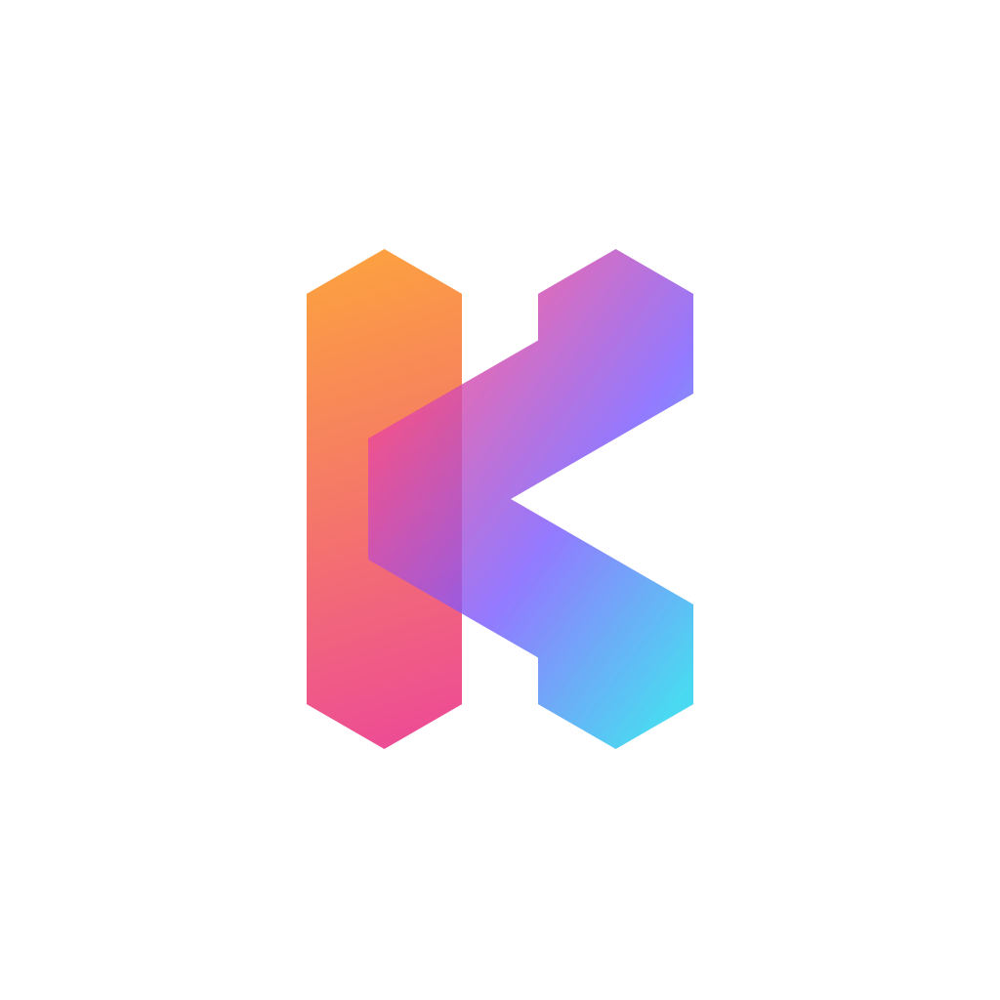

# Kovalent Homebrew Tap

<div align="center">
  
  <br />
  <strong>Homebrew formulae for Kovalent's command-line tools</strong>
  <br />
  <br />
  <a href="https://knaix.com">Knaix CLI</a> |
  <a href="https://kovalentai.com">Website</a> |
  <a href="https://docs.kovalentai.com">Documentation</a> |
  <a href="https://app.kovalentai.com">Live App</a>
  <br />
  <br />
  <a href="https://github.com/kovalentai/homebrew-tap/actions/workflows/ci.yml"></a>
  <a href="https://github.com/kovalentai/homebrew-tap/actions/workflows/ci.yml"></a>
  <a href="LICENSE"></a>
  
</div>

---

## Install the Knaix CLI

```sh
brew tap kovalentai/tap
brew install knaix
```

Or in one line, without tapping first:

```sh
brew install kovalentai/tap/knaix
```

Then start a node on your machine:

```sh
knaix local setup
```

Upgrades and removal work the way you expect:

```sh
brew upgrade knaix
brew uninstall knaix
```

Shell completion for bash, zsh, and fish is installed with the binary. No extra step.

## What gets installed

One binary, `knaix`. It is built for macOS and Linux on both Apple Silicon and x86, and it is
downloaded from `releases.knaix.com`. Homebrew checks the SHA-256 of the download against the
checksum recorded in the formula before it installs anything.

If you would rather not use Homebrew, `knaix.com` lists an install script and a direct download you
can verify yourself.

## About this repo

This repo holds the formula only. The CLI source lives elsewhere. The formula is updated
automatically when a new version of the CLI is published, and the update is refused unless the
binaries it points at are already live.

Docs: [knaix.com](https://knaix.com) &middot; Issues with the CLI itself belong on the Kovalent
issue tracker, not here.

The first install from any third-party tap asks you to trust it. That is Homebrew asking, not us,
and it is the same prompt you get for every tap outside homebrew-core.

## Working on the tap

Two things live here. `Formula/knaix.rb` is generated, and CI style-checks, audits, installs and
runs it on Apple Silicon, Intel and Linux. `scripts/render-formula.sh` is what generates it, from
whatever `releases.knaix.com` serves, and it has its own suite:

```sh
tests/render-formula.test.sh
```

No network and no ports: each case stands up its own release bucket as files, with
`tests/fake-curl` in place of `curl` on a trimmed `PATH`.

Coverage is measured the way CI measures it, and the floor in `tests/coverage.sh` is 100% of lines:

```sh
gem install bashcov && tests/coverage.sh
```

The report lands in `coverage/index.html`. macOS needs a bash newer than the 3.2 it ships
(`brew install bash`), since tracing uses `BASH_XTRACEFD`.
